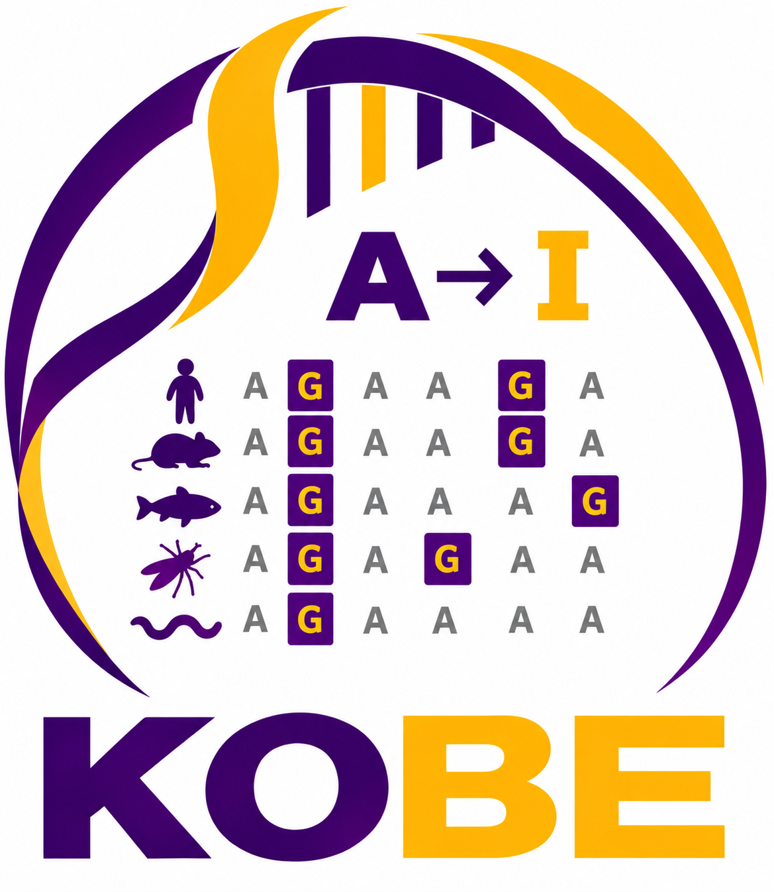

# KOBE
A command-line toolkit for A-to-I RNA editing identification and analysis.

  

<h1 align="center">KOBE</h1>

  <i>Kit for orthology-based editing analysis – 8 modules in 1</i>

  A command-line toolkit for A-to-I RNA editing identification and analysis.

